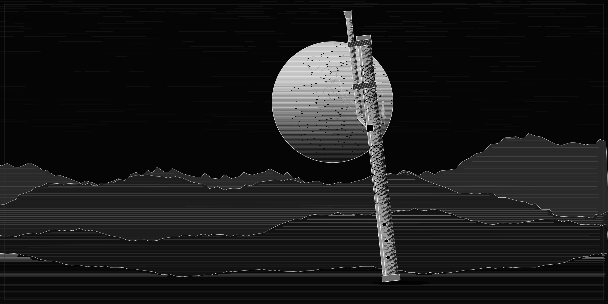
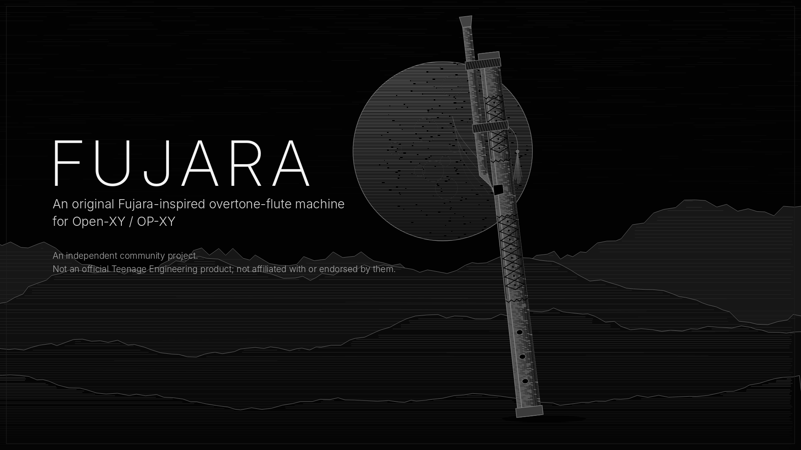
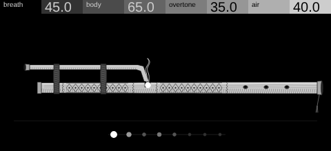

# Fujara

An original overtone-flute engine for the OP-XY, built on the
[Open-XY SDK](https://github.com/etcetc000/open-xy) (OS 1.2.1; tested on SDK
`staging` at `8d4bb49`, machine format SDK 1.6).



Inspired by the Slovak fujara: a long wooden overtone flute played through a
parallel air duct, where the player picks which harmonic speaks by how hard and
how precisely they blow. Fujara models that idea in a small all-integer
engine: a breath-blown jet sounding a tuned, resonant wooden bore, with breath
noise, an overblown attack that cascades down the harmonic series, and a
subtle unsteadiness of pitch. Its screen is a monochrome engraving of the
instrument.

Fujara is an independent community project. It is not a Teenage Engineering
product and is not affiliated with or endorsed by Teenage Engineering.

## Demo and preset tour

[](assets/fujara-demo.mp4)

▶ **[Watch the demo and preset tour (MP4, 2:47)](assets/fujara-demo.mp4)**.
Direct file: [`assets/fujara-demo.mp4`](assets/fujara-demo.mp4).

The video shows the four controls and plays each of the six presets. The sound
is Fujara's own `engine.cpp`, rendered offline from the same C++ the device
compiles, through a simple amp envelope standing in for the OP-XY's: no
effects, no samples. The screen is the machine's own `display.cpp` in the
Open-XY browser preview. [production/](production/README.md) rebuilds the
video from source.

## The screen



The engine's screen at the OP-XY's 480 × 220, captured from the Open-XY browser
preview running the machine's display code (Mountain Breath, a note held). The
browser's fonts stand in for the device's in the stock header; this is not a
photograph of an OP-XY.

| On the screen | Answers |
| --- | --- |
| The fujara, engraved: mouthpiece, air duct, leather bindings, burnt ornament, window, three finger holes, tassel | Static artwork, drawn once |
| The breath wisp over the window | Grows with **Breath** (14 to 60 px) and waves with **Air** |
| The overtone ladder: eight dots under the bore, fundamental first | Each dot's size and brightness is that partial's weight, from the same voicing code the engine uses. Each note replays the overblown cascade falling down the series, settling within 0.2 s |
| The window's glow | Lit while notes are held |

An idle screen stays still: unchanged frames are identical, so the device
redraws nothing. Reduced motion and track changes show the end state at once.

## Controls

Four controls on the stock header, in this order (saved sounds depend on it):

| Encoder | Control | What it does |
| --- | --- | --- |
| Blue | **Breath** | Excitation. Level and brightness rise; the emphasis overblows up to 0.75 partial higher; the attack overblows further; pitch sharpens by up to 8 cents and wanders 2 to 7 cents rms; past the middle the tone is driven (gain 1 to 2.75 into a soft curve) |
| Green | **Body** | The fundamental's weight and the bore's resonance (feedback 0.52 to 0.94) with darker wood losses |
| White | **Overtones** | Moves a narrow emphasis up the harmonic series, from the 2nd partial to the 7th, and thins the fundamental: the fujara's whistle. The device header shows this control as *overtone* (labels are at most eight characters) |
| Orange | **Air** | Breath noise: a pitched part that resonates in the bore and a free hiss |

All four are amounts 0 to 100 in the header. Defaults are Mountain Breath. The
OP-XY's own envelopes, filter, LFOs and FX follow the engine, as for every
machine; Fujara does not duplicate them.

## Presets

Six presets ship in [presets/](presets) and install with the builder. Mountain
Breath is the default (`default.json`).

| # | Preset | Breath | Body | Overtones | Air | Sound and use |
| --- | --- | --- | --- | --- | --- | --- |
| 1 | **Mountain Breath** (default) | 45 | 65 | 35 | 40 | Warm, woody and airy; the whistle on the 4th partial. The foundational fujara voice for slow melodies around D3 |
| 2 | **Overtone Wraith** | 55 | 35 | 90 | 30 | A thin fundamental under a whistle on the 7th partial: ghostly harmonics for held tones and drones |
| 3 | **Mourning Wood** | 22 | 85 | 12 | 25 | Soft breath and a dark bore, almost no noise: intimate, low laments (A1 to A2) |
| 4 | **High Pasture** | 40 | 20 | 62 | 85 | Very airy over a thin bore, the 5th partial singing: light, quick lines in the upper register (D5 and up) |
| 5 | **Storm Calling** | 95 | 55 | 78 | 45 | Forceful, driven breath: big overblown attacks, a whistle on the 7th partial, the most pitch wander |
| 6 | **The Hollow Saint** | 30 | 100 | 62 | 55 | The bore at full resonance with a long release: drones and slow ceremonial lines (D1 to D3) |

Measured on a sustained A3 by [tests/presets.cpp](tests/presets.cpp) (levels
relative to full scale, after the attack):

| Preset | Level | Strongest upper partial | Breath noise share | Spectral centroid |
| --- | --- | --- | --- | --- |
| Mountain Breath | −12.6 dB | 4th | −26.6 dB | 1.31 f0 |
| Overtone Wraith | −11.8 dB | 7th | −22.1 dB | 2.12 f0 |
| Mourning Wood | −13.2 dB | 3rd | −35.8 dB | 1.26 f0 |
| High Pasture | −13.4 dB | 5th | −14.8 dB | 2.09 f0 |
| Storm Calling | −10.4 dB | 7th | −17.5 dB | 2.32 f0 |
| The Hollow Saint | −14.6 dB | 5th | −24.8 dB | 1.34 f0 |

These are measurements, not listening notes. The presets have been rendered,
analysed and assembled into the demo, but they have not been auditioned on an
OP-XY. Preset envelopes (attack 300 to 4200, release 7000 to 20000) are in
[generators/presets.py](generators/presets.py); every preset keeps octave 0.

## Sound model

Everything is fixed point: Q15 audio in 32-bit words, 16-bit multiplies, no
floating point, no 64-bit arithmetic and no division per sample.

- **Jet**: eight harmonic partials, each a parabolic sine whose phase is
  exactly *h* times the fundamental's, with weights from Breath, Body and
  Overtones ([voicing.h](voicing.h)). Weights are normalised, so the jet's level
  depends only on Breath, and they glide across each block, so re-voicing never
  clicks. Partials above about 15 kHz are skipped, and silent partials cost
  nothing.
- **Breath**: low-passed noise less its rumble, modulated by the jet (turbulence
  riding on the oscillation).
- **Bore**: a delay line one period long with a linear-interpolated read and a
  one-pole wood filter in the loop, its lag subtracted so the resonances sit on
  the jet's harmonics at every MIDI note (halved below 44 Hz, doubled above
  10 kHz, still on the series). The input is scaled by (1 − g), so resonance
  peaks have unity gain; that bounds the line without a clamp.
- **Attack and pitch**: each note restarts an overblown attack (the emphasis
  lifted by up to three partials, falling back over about 120 ms) and a
  pitch scoop from up to 22 cents flat. A slow random wander and
  breath sharpening bend the block's increments.
- **Drive and output**: a gain of 1 to 2.75 into 1.5u − 0.5u³, a breath trim, a
  3.4 Hz DC blocker and a clamp to the declared peak (half scale).

Notes start without resetting phase or bore, so legato and retriggers do not
click. Details and the reasoning behind them are in [AUDIT.md](AUDIT.md).

## Polyphony, memory and CPU

`voiceCapacity` is 8, stock's per-track note limit. A voice is 2,144 bytes
(mostly the 1,024-sample bore), so the voice pool, with stock's spare voice, is
about 19 KiB of the shared 2,032 KiB module memory. The render uses 896 bytes of
stack.

| Reading | Result |
| --- | --- |
| Compiled Blackfin render loops, instructions per sample, heaviest setting (all 8 partials) | about 200 with a steady pitch, about 216 while gliding: about 12,800 to 13,800 per voice block |
| SDK host-timed estimate, instructions per voice block (7 runs) | 11,200 to 28,000, median 16,900. In the same session 2op FM measured 13,800 to 19,500 (median 18,100; published about 14,000). This host's timing is noisy |
| Cost by control setting (host timing) | flat: every swept setting within 2% of the others |

The aim is at most 15,000 per voice block, and the catalog recommends at most
3.5% of the stock block budget on the device. **Fujara has not been measured
on an OP-XY.** Host estimates and instruction counts are not device timings;
the hardware readout from the SDK's
[profiling guide](https://github.com/etcetc000/open-xy/blob/staging/docs/profiling.md)
is pending. See the [release checklist](RELEASE_CHECKLIST.md); on a Mac,
[tools/mac/](tools/mac/README.md) runs it without typing commands.

## Build, preview and test

Check out the SDK beside this repository (CI pins `8d4bb49`), then from this
repository's parent:

```sh
python open-xy/sdk.py preview --source Fujara-Flute-for-XY --out open-xy/local/fujara-preview-001
python open-xy/tools/serve_harness.py --preview open-xy/local/fujara-preview-001
python open-xy/sdk.py test --machine Fujara-Flute-for-XY --host-cxx g++
python Fujara-Flute-for-XY/tests/check_release.py --media
```

Open http://127.0.0.1:8917/, play keys or **Play phrase**, and pick presets.
`sdk.py test` runs the SDK's ABI, memory, peak, lifecycle and drawing checks
and the seven host test programs below. For a device build, follow the
[release checklist](RELEASE_CHECKLIST.md): it needs the SDK's pinned Blackfin
tools and your own stock `os.ldr`, kept outside every checkout.

| Test | Checks |
| --- | --- |
| [tests/sound.cpp](tests/sound.cpp) | 17 control settings (all corners and the middle) at 12 pitches from MIDI 0 to 127, with restarts: within the declared peak and audible. 4,000 blocks of hostile control words and jumping pitch buffers stay bounded |
| [tests/presets.cpp](tests/presets.cpp) | The six presets with 8 voices, stolen voices, a sweep and pitch bends: bounded, audible, not too loud, DC under 0.002. Each pair of presets differs measurably (level, noise share, centroid, whistle partial or fundamental) |
| [tests/tuning.cpp](tests/tuning.cpp) | At Breath 0 every note from MIDI 24 to 108 is within 1.5 cents; each preset sits at its intended breath sharpening within 3 cents; the bore is within 0.2% of the note's period at every MIDI note and Body setting. Overtones climbs the series, Air adds noise, Body weights the fundamental, Breath brightens, and the attack cascades down |
| [tests/voices.cpp](tests/voices.cpp) | Voices share no state; a stolen voice, initialised again, matches a fresh one sample for sample; retriggers and control jumps do not click; destroy changes nothing; glides stay bounded |
| [tests/stability.cpp](tests/stability.cpp) | 20 minutes of the most resonant and driven settings at MIDI 0, 40 and 127: the bore stays within its proven bound, the output within the peak, DC under 0.0005, and notes keep sounding |
| [tests/display.cpp](tests/display.cpp) | 20,000 random frames valid; the wisp keeps 64 distinct points and area and changes its key with its shape; idle and held screens are still; reset and track changes never fabricate a note; reduced motion jumps; the cascade settles in 0.2 s; the ladder follows Overtones |
| [tests/render.cpp](tests/render.cpp) | Bit-exact output of a fixed workload hashes to the recorded value (the same on GCC and Clang) |
| [tests/check_release.py](tests/check_release.py) | Presets, generators and artwork reproduce byte for byte; preset files are valid; README links resolve; with `--media`, every asset has its documented size and the MP4 is H.264/AAC, 2 to 4 minutes |

CI ([.github/workflows/machine.yml](.github/workflows/machine.yml)) runs all of
this, the tests again under UndefinedBehaviorSanitizer and AddressSanitizer,
and a native Blackfin compile with the SDK's pinned tools.

## Files

| Path | Owns |
| --- | --- |
| [definition.json](definition.json), [machine.json](machine.json) | Controls, presets, resources, drawing budget; kind, SDK version, preset envelope defaults |
| [core.h](core.h), [engine.cpp](engine.cpp), [voicing.h](voicing.h) | Voice state, the integer DSP, the partial weights shared with the display |
| [display.h](display.h), [display.cpp](display.cpp), [panel.svg.fragment](panel.svg.fragment) | The screen |
| [presets/](presets) | The six device presets, generated from definition.json |
| [generators/](generators) | `presets.py` and `panel.py`, which write presets/ and the artwork |
| [tests/](tests) | Host tests and release checks |
| [production/](production/README.md) | Scripts that make the artwork, the device screenshot and the demo video |
| [assets/](assets) | Hero artwork (PNG and JPEG), device screenshot, thumbnail, demo video and poster |
| [tools/blackfin_loops.py](tools/blackfin_loops.py) | Counts instructions in compiled Blackfin loops (a development aid) |
| [tools/mac/](tools/mac/README.md) | A double-click Mac script that builds the profiling firmware and measures CPU on your OP-XY |
| [AUDIT.md](AUDIT.md), [RELEASE_CHECKLIST.md](RELEASE_CHECKLIST.md), [CHANGELOG.md](CHANGELOG.md) | Design and verification record, release steps, history |

## Licence

MIT; see [LICENSE](LICENSE). Third-party tools and fonts used to make the
assets, none of which is distributed here, are listed in
[THIRD_PARTY_NOTICES.md](THIRD_PARTY_NOTICES.md). "OP-XY" and "Teenage
Engineering" are named only to say what this engine runs on.
